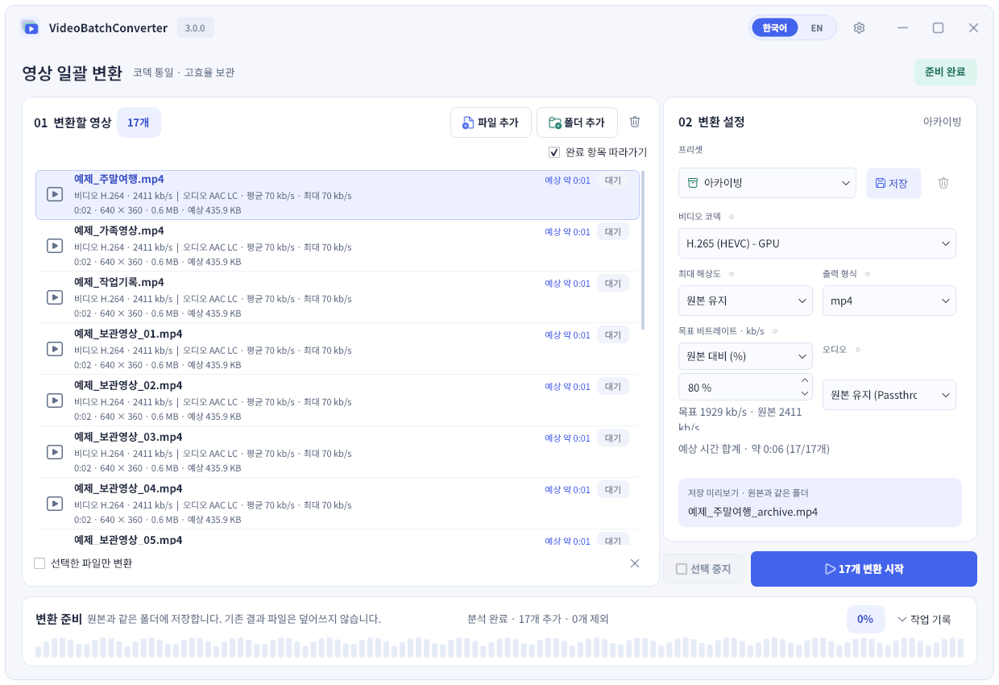
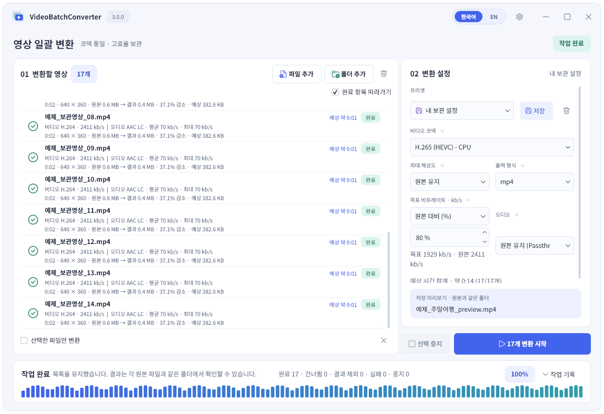

<p align="center"></p>

<p align="center"><strong>여러 영상의 코덱을 통일하고, 화질 우선의 고효율 인코딩으로 보관 용량을 줄입니다.</strong><br>Windows 동영상 일괄 변환기 · <strong>3.0.0 · 2026-11-17</strong></p>

<p align="center"><a href="https://github.com/deuxdoom/VideoBatchConverter/releases/download/v3.0.0/VideoBatchConverter-3.0.0-windows-x64.zip">Windows 64비트 다운로드</a> · <a href="https://github.com/deuxdoom/VideoBatchConverter/releases/tag/v3.0.0">3.0.0 릴리스</a> · <a href="index.html">소개 페이지 소스</a> · <a href="changelog.md">변경 기록</a> · <a href="assets/brand/brand-guide.md">브랜드 가이드</a></p>



## 두 가지 목적에 맞춘 변환

- **재생 형식 통일:** 코덱·해상도가 서로 다른 영상들을 H.264/AAC MP4로 맞춰 YouTube 업로드, iPad·Android 태블릿 등에서 재생하기 편하게 만듭니다.
- **보관 공간 절약:** 아카이빙 프리셋은 원본 해상도를 유지하면서 HEVC로 변환합니다. 기본 VBR 목표는 원본 비디오 비트레이트의 80%이며, 결과가 원본보다 크면 추가 결과를 보관하지 않습니다.

4K·FHD·720p·그 이하의 영상을 한 번에 담을 수 있습니다. 1080p/720p는 해상도 상한이므로 작은 영상을 확대하지 않습니다. 손실 압축이며 원본과 같은 화질이나 일정한 용량 감소를 보장하지 않습니다. 실제 샘플 예측과 고품질 인코더 옵션으로 설정을 확인합니다.

> **3.0.0 정식 배포 · 2026-11-17.** [Windows 64비트 ZIP](https://github.com/deuxdoom/VideoBatchConverter/releases/download/v3.0.0/VideoBatchConverter-3.0.0-windows-x64.zip)을 내려받아 압축을 풀고 `VideoBatchConverter.exe`를 실행하세요. EXE와 `bin` 폴더를 함께 유지해야 합니다. FFmpeg·FFprobe는 첫 실행에서 자동 설치하므로 최초 실행에는 인터넷 연결이 필요합니다.

## 세 가지 기본 프리셋

| 프리셋 | 출력 | 해상도 | 화질 설정 | 오디오 | 기본 결과 |
| --- | --- | --- | --- | --- | --- |
| **아카이빙** | HEVC · MP4 | 원본 유지 | VBR · 원본 비디오의 80% | 원본 복사 | `여행_archive.mp4` |
| **1080p** | H.264 · MP4 | 최대 1080p | VBR · 원본 비디오의 80% | AAC 평균 목표 최대 192 kb/s | `여행_1080p.mp4` |
| **720p** | H.264 · MP4 | 최대 720p | VBR · 원본 비디오의 80% | AAC 평균 목표 최대 192 kb/s | `여행_720p.mp4` |

기본은 NVIDIA NVENC `p6`와 HQ·멀티패스·적응형 양자화·룩어헤드를 사용합니다. 지원하는 NVIDIA GPU와 드라이버가 필요합니다. GPU를 사용할 수 없으면 코덱에서 CPU를 선택하세요. CPU도 VBR이 기본이며 H.264/HEVC는 `slow`를 사용합니다. 평균 목표는 `-b:v`, 최대 비트레이트와 버퍼는 `-maxrate`·`-bufsize`로 전달합니다. [NVIDIA FFmpeg 가이드](https://docs.nvidia.com/video-technologies/video-codec-sdk/13.1/ffmpeg-with-nvidia-gpu/index.html)를 참고했습니다.

기본 세 프리셋은 **VBR · 원본 대비 80%**로 시작합니다. 비트레이트 설정은 **원본 대비 (%) / 직접 입력 (kb/s)** 두 방식으로 나뉩니다. 비율 방식에서는 사용자가 1~200%를 직접 입력하고 파일별 원본 비디오 평균값에 적용합니다. 예: 원본 10000 kb/s의 80%는 8000 kb/s입니다. 비율도 사용자 프리셋에 저장합니다. 직접 입력은 **kb/s 고정 단위**이며 `6000`은 `6000 kb/s`입니다. 전체 비트레이트를 영상 값으로 대신 쓰지 않으며, 스트림 값이 없을 때만 뒤에서 추가 분석합니다. 기존 저장값 `6M`·`192k`는 각각 `6000`·`192`로 이관하며, 이전 단위 없는 저장값은 당시 bits/s 의미를 유지해 이관합니다. 사용자 CQP/CRF 프리셋과 수동값은 보존합니다.

HDR(PQ/HLG)은 아카이빙 시 10비트 출력과 원본 색상 태그를 유지합니다. H.264 범용 출력에서는 SDR BT.709로 톤 매핑합니다. 이미 적합한 비트레이트의 AAC 오디오라면 자동 설정에서 재압축을 피하고 복사합니다. [FFmpeg 색 변환 문서](https://ffmpeg.org/ffmpeg-filters.html#tonemap)를 참고했습니다. Dolby Vision 같은 동적 HDR 메타데이터, 추가 오디오·자막·첨부 트랙의 보존은 지원 범위에 포함하지 않습니다.

## 사용 방법

1. **파일·폴더 추가:** 빈 목록을 클릭하면 파일과 폴더를 함께 고르는 창이 열립니다. 폴더를 더블클릭하면 내부로 이동하고 `현재 폴더 추가`로 폴더 전체를 담을 수도 있습니다. 파일/폴더 추가 버튼과 드래그 앤 드롭도 지원합니다.
2. **분석과 설정:** 하위 폴더까지 영상 코덱·해상도·비트 깊이·재생 시간을 분석합니다. 오른쪽 드롭다운에서 아카이빙·1080p·720p 또는 저장한 내 프리셋을 선택하세요. GPU 프리셋·압축 방식·접미사·동시 작업 수 등은 우측 상단 `설정 → 고급`에서 조정합니다.
3. **일괄 변환:** 기본은 목록 전체입니다. 일부만 처리하려면 파일을 선택하고 `선택한 파일만 변환`을 켜세요. 출력은 원본과 같은 폴더에 저장하며 미리보기에서 이름과 확장자를 확인할 수 있습니다.

목록의 각 행에는 **비디오·오디오 각각의 코덱과 비트레이트**, 영상 길이·해상도·용량과 대기·진행률·완료·실패·결과 제외 배지가 표시됩니다. 비디오·오디오·전체 비트레이트는 모두 `8500 kb/s`처럼 정수 kb/s를 사용합니다. 첫 번째 실제 영상과 첫 번째 오디오를 기준으로 하며, 누락된 스트림 비트레이트는 `—`, 전체 비트레이트는 별도로 표시합니다. 오디오가 없으면 `오디오 없음`으로 표시합니다. 완료한 행에는 원본/결과 크기와 감소·증가 비율도 남습니다. `완료 항목 따라가기`는 선택을 바꾸지 않고 최근 처리 행으로 스크롤합니다.

AAC LC는 평균과 파일에 기록된 최대 비트레이트를 구분합니다. MP4의 선택된 오디오 트랙에서 `esds`/`btrt` 헤더를 읽으며 **순간 패킷 값을 최대값으로 사용하지 않습니다**. 최대 메타데이터가 없으면 `최대 —`로 표시합니다. MKV 등에 평균값이 없으면 기본 정보를 먼저 표시한 뒤, 한 번의 추가 패킷 분석으로 누락된 비디오·오디오 평균을 함께 계산합니다. 컨테이너의 정밀도가 낮은 패킷 길이를 더하는 대신 실제 타임스탬프 간격을 사용합니다. [FFmpeg의 MP4 descriptor 처리](https://github.com/FFmpeg/FFmpeg/blob/master/libavformat/isom.c)를 참고했습니다.

TrueHD 원본 복사와 MP4를 함께 선택하면 샘플 변환 전 설정 확인으로 안내합니다. AAC 변환이나 MKV를 선택하세요. MKV의 스트림 BPS 태그도 영상·오디오 평균값으로 읽습니다. FFprobe의 JSON과 경고 출력을 분리하여 챕터 경고가 있어도 샘플 패킷 정보를 정상적으로 읽습니다.

파일을 추가하면 **분석 전에 행부터 표시**합니다. 목록 순서로 최대 4개 기본 정보 작업을 배정하고, 완료된 행부터 정보를 갱신하되 목록 순서는 유지합니다. 비디오·오디오 평균 비트레이트가 누락된 경우의 추가 분석은 기본 정보 표시 뒤에 수행합니다. 분석 실패·중지 행은 목록에 이유와 함께 남고 변환 대상에서 제외하며, 우클릭의 **정보 다시 분석**으로 재시도할 수 있습니다. 폴더에서 발견한 앱 생성 결과는 메타데이터 확인 후 제외합니다.

파일을 추가하거나 인코딩 설정을 바꾸면 짧은 실제 샘플로 **영상별 예상 변환 시간과 용량**을 자동 계산합니다. 각 행의 예상 용량은 현재 설정에 맞춰 갱신하며, 재계산 중에는 이전 값 대신 계산 상태를 표시합니다. 1MB 미만은 KB로 표시합니다. 각 행에 시간을 표시하고 오른쪽에는 변환 대상 파일의 시간 합계를 표시합니다. 합계는 개별 파일 시간을 더한 값이며 동시 작업 수·PC 부하·샘플 구간에 따라 실제 완료 시간은 달라집니다. 계산 실패는 `—`와 이유를 표시합니다. 같은 파일·인코딩 조건의 샘플은 사전 용량 확인에도 재사용하며, 설정 변경·실제 변환 시작·종료 시 이전 샘플 작업을 취소하고 정리합니다.

우측 상단 **설정 버튼**은 왼쪽 카테고리로 이동하는 설정창을 엽니다. **일반·고급·폴더·도움말·정보**에서 언어/완료음, 모든 고급 인코딩 옵션과 사전 용량 예측/GPU 처리, 파일 추가 시작 폴더와 프로그램 정보 등을 관리합니다. 변경은 즉시 저장되고 작업 중에는 변환 관련 항목을 잠급니다. 툴팁은 핵심만 짧게 표시하며, 각 항목의 `ⓘ` 버튼은 도움말의 해당 상세 설명으로 바로 이동합니다.

우측은 **02 변환 설정을 길게 확보**하고 아래에는 중지·변환 시작 버튼만 둡니다. 별도의 03 카드는 없습니다. 하단 **애니메이션 그래프 바**는 재생 시간·픽셀 수로 가중한 실제 FFmpeg 진행률을 표시합니다. `작업 기록`은 별도 창으로 열려 목록 높이를 줄이지 않습니다.

변환 중에는 중지할 행을 선택한 뒤 **선택 중지**를 누릅니다. 선택한 실행·대기 항목만 취소하고 나머지 변환은 계속합니다. 선택이 없으면 버튼을 비활성화하며, 전체 중지는 목록 우클릭 메뉴의 **전체 작업 중지**에서 실행합니다. 검색·용량 예측 중의 버튼은 해당 검사 전체를 중지합니다.

목록 상단의 제목·개수·추가 버튼을 한 줄로 묶고 중복 정보 영역과 행 여백을 줄여, 같은 창에서 더 많은 영상을 확인할 수 있습니다.

배치가 끝나면 짧은 완료음을 한 번 재생하며 `설정 → 일반`에서 끌 수 있습니다. 중지와 용량 예측만 마친 경우에는 재생하지 않습니다. 종료 버튼과 Alt+F4는 간단한 확인창을 거치며, 작업 중에는 실행·대기 작업과 임시 결과를 정리한 뒤 종료합니다.

우측 상단 **한국어 / EN** 스위치로 앱의 표시 언어를 즉시 바꿀 수 있습니다. 설정·도움말·대화상자·진행 상태·작업 기록이 함께 전환되고, 선택한 언어는 재실행 후에도 유지됩니다. 변환 중에도 전환할 수 있으며 파일명·사용자 프리셋 이름·인코딩 설정은 그대로 유지합니다. 소개 페이지에도 같은 스위치가 있으며 브라우저에서 언어 선택을 기억합니다. 앱과 웹의 언어 선택은 각각 저장됩니다.



## 내 프리셋

원하는 코덱·해상도·품질·오디오·접미사·동시 작업 수를 설정하고 프리셋 옆 **저장**을 누르세요. 사용자 이름은 세 가지 기본 프리셋 뒤에 그대로 표시되며 재실행 후에도 유지됩니다.

같은 이름은 확인 후 덮어쓰고, 내 프리셋을 선택한 뒤 휴지통으로 삭제할 수 있습니다. 삭제해도 현재 인코딩 값은 유지합니다. 파일 목록·폴더 경로는 프리셋에 포함하지 않습니다. 기존 사용자 프리셋은 자동 품질·큰 결과 제외 옵션을 꺼 둔 수동 설정으로 호환 복원하며, 폐기한 기본 프리셋은 새 세 가지 프리셋으로 이관합니다.

## 원본과 저장 공간

기본으로 **변환 전 예상 용량 확인**을 진행합니다. 긴 영상은 10%·50%·90% 부근에서 각각 4초씩 선택한 설정으로 인코딩하고 크기를 추정합니다. 12초 이하의 짧은 영상은 전체 길이를 샘플로 사용합니다. 샘플은 격리된 임시 폴더에 만들고 정리합니다. [FFmpeg의 탐색·시간 제한 옵션](https://ffmpeg.org/ffmpeg.html#Main-options)을 사용합니다.

탐색 지점 앞에 남은 복사 오디오는 샘플에서 제외하고, 영상 패킷의 실제 재생 구간을 기준으로 용량을 계산합니다. MKV의 타임스탬프 이동이나 MP4의 재생 시간 표기 차이로 예상 용량이 크게 달라지지 않도록 처리합니다. 프레임은 컨테이너의 자동 동기화로 복제·삭제하지 않고 원본 타임스탬프를 유지합니다. [FFmpeg의 fps_mode](https://ffmpeg.org/ffmpeg.html#Advanced-Video-options)를 사용합니다.

첫 주의 파일이 나오면 즉시 멈춰 **설정 조정 / 주의 파일 제외 / 그대로 진행**을 선택하게 합니다. 예상 크기가 원본의 95% 이상이거나 예측에 실패한 파일을 안내하며, 선택은 이후 주의 파일에도 적용합니다. 추정값은 실제 크기를 보장하지 않습니다. 같은 파일·설정의 예측은 재사용하고, 고급 설정에서 사전 확인을 끌 수 있습니다.

**CQ/CRF 숫자를 높이면** 화질 목표를 낮춰 용량을 줄이는 방향입니다. 자동 품질 사용 중에는 이를 해제한 뒤 수동 값을 조정하세요. VBR/CBR에서는 비트레이트를 낮춥니다. 원본이 이미 효율적으로 압축됐다면 추가 절감이 작을 수 있습니다.

완료한 용량 예측은 목록을 유지하는 동안 캐시합니다. 중지 후 **같은 파일·인코딩 설정**으로 다시 시작하면 샘플 변환을 반복하지 않고 `예측 재사용`으로 표시합니다. 파일의 크기·수정 시각이나 인코딩/GPU 설정이 바뀌면 다시 예측합니다. 접미사·동시 작업 수만 바꾸면 기존 예측을 유지하고, 미완료·실패한 예측은 재시도합니다. 목록을 비우면 캐시도 비웁니다.

- 원본은 자동 삭제하지 않습니다. 결과를 확인한 뒤 원본을 정리할지는 사용자가 결정합니다. 화면의 감소율은 결과 파일과 원본의 크기 비교이며 즉시 확보된 디스크 공간을 뜻하지는 않습니다.
- 아카이빙의 `원본보다 커진 결과는 보관하지 않음`이 켜져 있으면 결과가 원본 이상 크기일 때 **결과 제외**로 표시하고 원본/결과 크기와 이유를 기록합니다. 저장된 결과가 하나도 없으면 별도 안내를 표시합니다. 용량보다 코덱 통일이 우선이면 이 옵션을 끄세요.
- 기존 결과 파일은 덮어쓰지 않고 건너뜁니다. 다른 결과를 만들려면 접미사를 바꾸세요. 프리셋마다 기본 접미사가 달라 1080p와 720p 결과가 충돌하지 않습니다.
- 앱이 만든 결과는 폴더 자동 검색에서 제외해 반복 재인코딩을 피합니다. 결과 파일을 명시적으로 선택하면 다시 변환할 수 있습니다.
- 같은 폴더의 동명 파일이 같은 결과 경로를 만들면 시작 전에 안내합니다.
- 정상 중지·실패 시 고유 `.partial` 출력은 정리합니다. 전원 차단이나 강제 종료 후에는 남을 수 있습니다.

아카이빙 기본 결과는 **HEVC MP4 (`_archive.mp4`)**입니다. 이전의 기본 아카이빙 MKV 설정만 MP4로 이관하며, 사용자가 만든 프리셋과 수동 MKV 설정은 보존합니다. MP4가 원본 오디오 형식을 지원하지 않으면 AAC를 선택하세요.

## GPU 처리

GPU 코덱에서는 NVENC 인코딩에 더해, 지원하는 입력의 **NVDEC 디코딩과 CUDA 리사이즈**를 기본으로 사용합니다. 프레임을 GPU 메모리에서 처리하고 디코딩·가공·인코딩을 겹쳐 수행합니다. CUDA 처리를 사용할 수 없으면 같은 NVENC 품질 설정으로 소프트웨어 디코딩을 재시도합니다. HDR→H.264 SDR 톤 매핑은 기존 CPU 필터를 유지합니다. 고급 설정에서 GPU 전처리를 끌 수 있습니다. [NVIDIA 공식 FFmpeg 가이드](https://docs.nvidia.com/video-technologies/video-codec-sdk/13.1/ffmpeg-with-nvidia-gpu/)를 참고했습니다.

CQ·p6·HQ·룩어헤드는 유지하며 프레임 분할 인코딩을 강제하지 않습니다. RTX 4080 SUPER의 생성한 4K 30fps 6초 예제에서는 준비 실행을 제외한 중앙값이 **5.04초→4.79초**였고 비교한 6개 출력의 SHA-256이 같았습니다. 한 예제의 결과이며 모든 영상에서 같은 개선을 보장하는 측정은 아닙니다.

## 설치와 실행

권장 환경은 Windows 10/11 64비트입니다. 소스 실행·빌드는 Python 3.10 이상을 사용하세요. 공개 배포본은 [3.0.0 릴리스](https://github.com/deuxdoom/VideoBatchConverter/releases/tag/v3.0.0)의 ZIP을 받아 폴더 전체를 압축 해제한 뒤 실행합니다.

```powershell
python -m venv .venv
.\.venv\Scripts\python -m pip install -r requirements.txt
.\.venv\Scripts\python main.py
```

FFmpeg과 FFprobe가 없으면 첫 실행 시 설치합니다. 직접 준비한다면 소스의 `assets/ffmpeg/`에 두 바이너리를 넣으세요. 설정은 프로젝트 루트 또는 EXE 옆 `settings.ini`에 저장합니다. `error.log`는 인코딩·샘플 예측·설치 오류, 처리되지 않은 예외나 Qt의 치명적 오류가 발생할 때만 같은 위치에 생성합니다. 정상 실행·진행 정보·경고·사용자 중지는 파일로 기록하지 않습니다. 쓰기 가능한 폴더에서 실행하세요. 업데이트 확인과 FFmpeg 최초 설치에 인터넷을 사용하며 영상은 서버에 업로드하지 않습니다.

### Windows 빌드

```powershell
python -m pip install -r requirements-dev.txt
powershell -ExecutionPolicy Bypass -File tools/build_windows.ps1
python tools/package_windows.py --output-dir F:/Temp/VideoBatchConverter/release
```

```text
dist/VideoBatchConverter/
├─ VideoBatchConverter.exe
├─ LICENSE
└─ bin/
   ├─ PyQt6/ …                  Python·Qt 런타임
   ├─ brand/ · icons/ · fonts/   모든 브랜드·아이콘·글꼴
   ├─ i18n/                     영어 UI 번역
   ├─ audio/                    완료음과 CC0 고지
   └─ ffmpeg/                   ffmpeg.exe · ffprobe.exe
```

`assets`와 `_internal`을 **단일 `bin` 폴더**로 통합했습니다. EXE와 bin을 함께 유지하세요. 배포본의 FFmpeg 최초 설치 위치도 `bin/ffmpeg/`입니다. 로컬 바이너리가 있으면 개발 빌드 시 복사합니다. 공식 배포 ZIP은 FFmpeg 바이너리를 포함하지 않고 최초 실행 시 원본 배포처에서 설치합니다. Windows 배포본의 의존성 고지와 소스 안내는 `bin/licenses/`에 동봉합니다.

앱과 웹은 **Noto Sans CJK KR 한 가지 계열**로 통일했습니다. Regular/Bold를 동봉하고 웹은 한글·라틴 WOFF2를 사용합니다. 앱은 **No hinting과 그레이스케일 안티앨리어싱**을 적용하며, 드롭다운·파일 선택 목록에도 같은 설정을 유지합니다. Windows가 다크 모드여도 앱과 팝업·파일 목록·헤더는 밝은 팔레트를 사용합니다. 자폭을 변형하지 않고 네이티브 DPI로 그리며 라벨 하단 여백을 확보했습니다. [글꼴과 라이선스](assets/fonts/README.md)를 확인하세요.

## 개발과 검증

```powershell
python -m pytest -q --basetemp=F:/Temp/VideoBatchConverter/pytest
python tools/generate_web_fonts.py
python tools/generate_brand_assets.py
python tools/capture_screenshots.py --work-dir F:/Temp/VideoBatchConverter/examples
python tools/capture_screenshots.py --work-dir F:/Temp/VideoBatchConverter/examples-en --language en
python tools/check_windows_ui.py --artifacts F:/Temp/VideoBatchConverter/windows-qa --scale 1.5
```

선택적으로 Playwright·Chromium 설치 후 `python tools/check_site.py --artifacts F:/Temp/VideoBatchConverter/site-qa`로 브라우저를 검사할 수 있습니다. `index.html`은 직접 열거나 GitHub Pages의 저장소 루트 진입점으로 사용할 수 있습니다.

검증에는 프리셋 영속성, 혼합 파일/폴더 선택, 대량 큐, 실제 병렬 변환, 중지·종료, 더 큰 결과 제외, HDR 설정, 애니메이션 진행률을 포함합니다. RTX 4080 SUPER에서 4K/FHD/720p/360p × 3개 프리셋 12건과 10비트 HDR 보존/SDR 변환 2건을 별도로 확인했습니다. 예제 영상 검사이며 모든 원본의 용량 감소나 지각적 화질을 보장하는 수치는 아닙니다.

주요 코드: `src/ui_mainwindow.py`, `profiles.py`, `worker.py`, `queue_widgets.py`, `encoding_progress.py`, `source_picker.py`, `fonts.py`, `paths.py`. 언어 전환은 `src/i18n.py`·`localized_widgets.py`·`language_switch.py`, 앱 번역은 `assets/i18n/en.json`, 웹 번역은 `assets/site/language.js`에서 관리합니다. 자산은 `assets/brand/`, `icons/`, `fonts/`, `social/`, `screenshots/`에 있습니다. 임시 작업은 `F:\Temp\VideoBatchConverter`, 필요한 로컬 검증 기록은 커밋 제외 `.local/verification/`에 보관합니다.

단축키: `Ctrl+O` 파일 추가, `Ctrl+Shift+O` 폴더 추가, 목록에서 `Delete` 선택 삭제, `Alt+F4` 종료.

## 라이선스

프로젝트 소스는 [MIT License](LICENSE)를 따릅니다. Windows 배포본에는 GPLv3 PyQt6와 LGPL Qt 등 각 라이선스를 따르는 의존성이 포함되며, 통합 배포본의 GPLv3 고지·원문·대응 소스 안내는 `bin/licenses/`와 [의존성 고지](THIRD_PARTY_NOTICES.md)에서 확인할 수 있습니다. Fluent 아이콘은 [Microsoft MIT 고지](assets/icons/LICENSE), 글꼴은 [SIL OFL 고지](assets/fonts/LICENSE-Noto.txt)를 따릅니다. 완료음은 [Kenney Interface Sounds(CC0)](https://opengameart.org/content/interface-sounds)이며 [원본 고지와 변환 내역](assets/audio/README.md)을 동봉합니다. FFmpeg은 별도 프로젝트이며 사용한 빌드의 라이선스가 적용됩니다.
